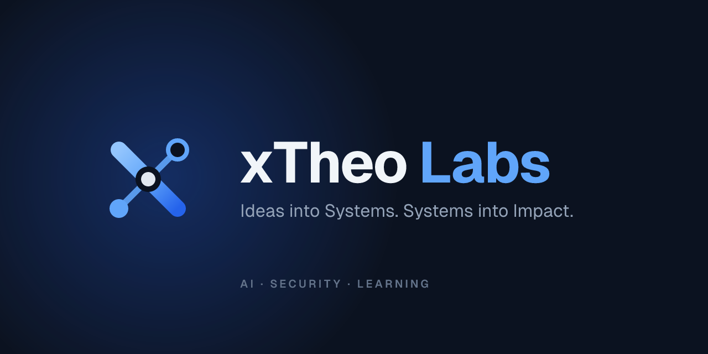

  

# xTheo Labs

> Ideas into Systems. Systems into Impact.

**xTheo Labs** is the independent product studio of **Harasta Rahman Tri Putra** ([@xtheoputra](https://github.com/xtheoputra)), a System Analyst & Full-Stack Engineer. We build software across web, mobile, and desktop, focused on **AI**, **security**, and **learning**.

## Products

| Product | Category | Status | Link |
|---|---|---|---|
| **Silent Tears** | Windows · Security monitoring (MITRE ATT&CK, zero telemetry) | Pre-release | https://silent-tears-web.vercel.app/ |
| **ThinkMate** | AI · Decision support (Web) | Live | https://thinkmate-web.vercel.app/ |
| **Heirst** | Android · Privacy-first tools | Public beta | https://heirst-web.vercel.app/en |
| **TechVerse X** | EdTech · Learning platform | Live | https://techverse-x-web.vercel.app/ |
| **Jago Bahasa** | EdTech · 23-language learning PWA | Live · Open source | https://xtheoputra.github.io/jago-bahasa/ |

## Lab & portfolio

- 🌐 Labs site: https://xtheo-labs.vercel.app
- 👤 Founder: [@xtheoputra](https://github.com/xtheoputra), *also known as* Harasta Rahman Tri Putra
- 🏛️ Former handle: [@ataskaters](https://github.com/ataskaters) (2017 archive)

---

*Building in public. Systems that ship.*
